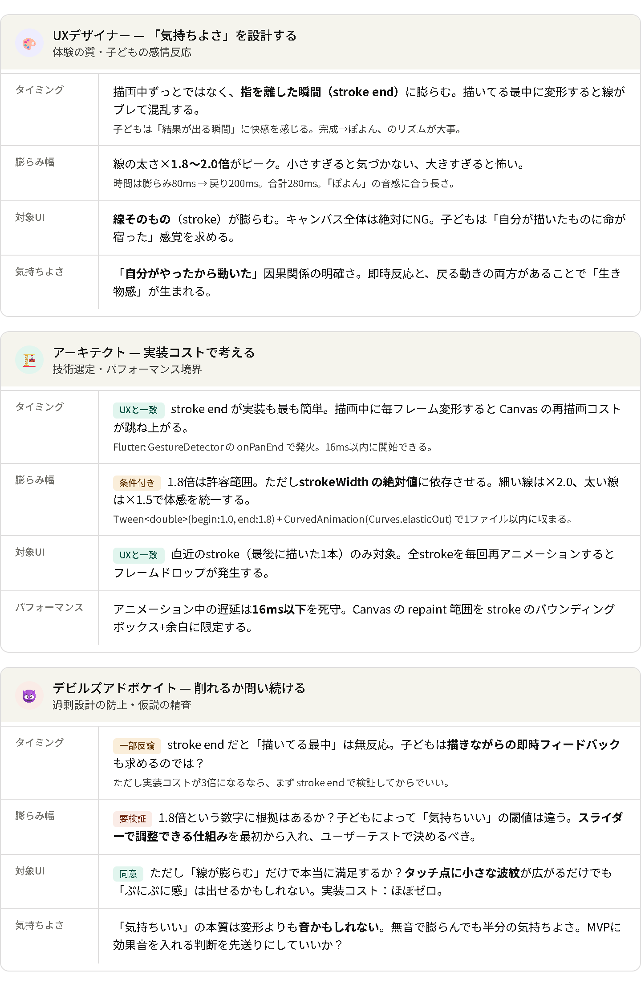

KEY
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

# リンク
[疑似AgentTeams_仕様](疑似AgentTeams_仕様.md)

##
3人の仮回答案をまとめました。

【UXデザイナー】
- 最小機能は「描ける」「ぷにぷに動く」「保存できる」の3つ
- 子どもは“最初の1タッチ”で世界が変わる体験を求める
- ぷにぷに感は「線を描いた瞬間に柔らかく変形する」だけで成立
- 色やブラシは最小限（3色＋太さ1種類）で十分
- UIはボタン3つ（色・消しゴム・保存）に絞るべき

【アーキテクト】
- MVPでは物理演算は不要、Canvas のスケール変形＋イージングで十分
- Flutter なら AnimatedContainer や TweenAnimationBuilder で実装可能
- キャンバスは CustomPainter で描画
- 保存はローカル保存のみ（クラウドは後回し）
- ぷにぷに演出は「描画時に線を一瞬膨らませて戻す」だけで成立

【デビルズアドボケイト】
- MVPで「色を増やす」「スタンプ」「レイヤー」などは不要
- ぷにぷに表現を凝りすぎると開発コストが跳ね上がる
- 子ども向けアプリは“複雑さ”が最大の敵
- 保存機能すら本当に必要か？
  → 最初は「スクショを促す」だけでも成立する
- 最小機能セットは「描く」「ぷにぷに動く」だけで十分検証可能

これらを踏まえて、最小機能セットの結論を出してください。

